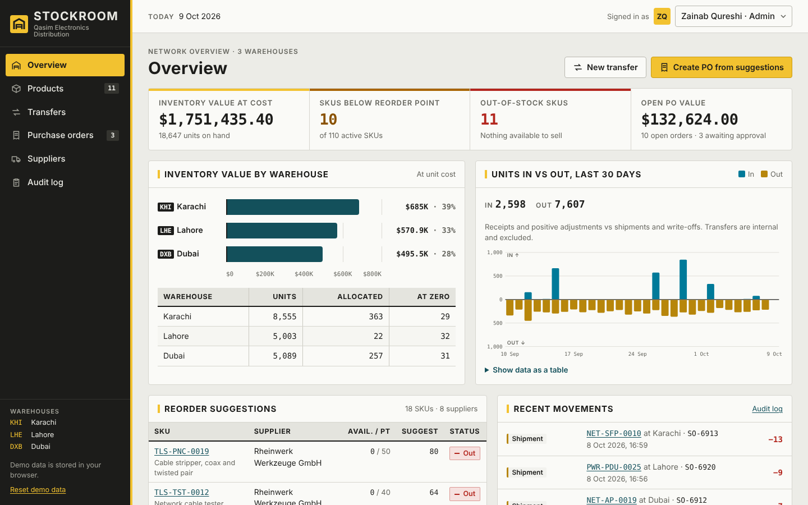

# Stockroom

Multi-warehouse inventory and purchasing for an electronics and hardware distributor. It tracks stock across Karachi, Lahore and Dubai, moves stock between them, runs purchase orders through approval and receiving, and records every change in an audit log.

Stockroom is a static web app with no backend and no build step. Demo data is generated in your browser and stored in `localStorage`.

Live demo: https://stockroom-yourname.vercel.app ← update after deploying



## Features

- **Overview dashboard**: inventory value at cost, SKUs below reorder point, out-of-stock SKUs and open PO value. It also has value by warehouse, a 30-day in vs out chart with tooltips and a table view, reorder suggestions and a feed of recent movements.
- **Products**: 110 SKUs with on hand per warehouse, available stock, reorder point and a status badge. The list has search, category, status and warehouse filters, sortable columns, pagination and CSV export. On phones it switches to a card list.
- **CSV import**: bulk-update reorder points, and optionally add new products, from a CSV. A preview shows the errors for each row (unknown SKU, non-numeric value, missing column, duplicate row), and you then apply only the valid rows. A template CSV is available to download.
- **Product detail**: on hand, allocated and available stock per warehouse. Reorder settings can be edited by Managers and Admins. The movement history shows a running balance per warehouse and can be filtered by type and warehouse. It also has an "Adjust stock" dialog with reason codes and the product's audit activity.
- **Transfers**: move stock between warehouses, limited to what is available at the source. Each transfer posts as a paired Transfer out / Transfer in.
- **Purchase orders**: create POs by hand or from reorder suggestions (one draft per supplier). The line editor shows live totals. Status runs Draft → Pending approval → Approved → Ordered → Partially received → Received, or Cancelled. Receiving can be partial. Each PO has a status timeline and a print layout.
- **Suppliers**: lead times, open PO value and product count. Admins can add and edit suppliers, with validation.
- **Audit log**: every change records who made it, their role, the action, the entity, a timestamp and before → after values. It can be filtered, searched, paginated and exported.
- **Roles**: switch between Zainab Qureshi (Admin), Hamza Iqbal (Manager) and Fatima Noor (Clerk) in the header.

## Architecture

```
index.html        app shell (sidebar, header, live regions)
style.css         tokens (light/dark), layout, components, print stylesheet
js/app.js         hash router + shell wiring
js/ledger.js      pure stock ledger functions (unit-tested)
js/csv.js         CSV parser/writer + import validation (unit-tested)
js/permissions.js role matrix and approval thresholds
js/store.js       state, persistence, permission checks, audit log
js/seed.js        deterministic demo data relative to today
js/ui.js          dialogs, toasts, sortable headers, pagination
js/views/*.js     one module per screen
```

- **Event-sourced ledger.** Stock on hand is never stored. `ledger.js` folds an append-only list of movements (Receipt, Shipment, Transfer out/in, Adjustment with a reason code) into balances per SKU and warehouse. Allocated stock comes from open sales orders, and available = on hand − allocated. A correction is a new adjustment, never an edit. `appendMovements` validates the whole batch and rejects anything that would take on hand below zero, with a message that says how to fix it.
- **Permissions enforced in the store.** Every mutation goes through `mutate(permission, fn)`. It checks the signed-in role, runs the change on a snapshot, rolls back on any error, writes an audit entry, then persists. The UI uses the same `can()` checks to disable buttons and explain why. Calling the store directly from the console is still refused.
- **Approval thresholds.** Managers can approve POs up to $5,000. Larger POs need an Admin (`assertCanApprove`), and only Admins can cancel. The PO editor warns before you submit if the total is over the threshold.
- **Audit log.** Each entry stores `{who, role, action, entity, timestamp, changes[{field, from, to}], note}`. The seeded history has matching entries for every seeded PO step, adjustment and transfer.
- **CSV parser.** It is a small state machine that handles quoted fields, commas, newlines and doubled quotes inside quotes, CRLF/LF/CR line endings, a BOM and unclosed quotes. On export it escapes values and neutralises formula injection.
- **Hash router.** Routes are regex patterns mapped to view modules. Views re-render on store events, and focus moves to the page heading on navigation.
- **Money and quantities** are integers: money in cents (USD), quantities in units.

## What was interesting to build

- **Making demo data consistent by construction.** The seed simulates 90 days in time order: opening counts, then PO receipts, transfers, shipments and adjustments. Shipments only draw on stock that exists at that moment, so the ledger never dips below zero. A unit test replays every movement to check this.
- **Deriving instead of storing.** With stock derived from movements, a running balance, the 30-day flow chart and the "below zero" guard all come from one fold. Derived values are memoised per state version, so this stays fast with about 3,000 movements.
- **Permission UX that explains itself.** Blocked actions stay visible and focusable. They are marked `aria-disabled` and say exactly why, for example "POs over $5,000 need Admin approval", instead of disappearing.
- **CSV import as a two-phase commit.** The file is parsed and validated against live data first. You see what each row will change, and only rows with no errors are applied, in one atomic, audited mutation.

## Tech

- Vanilla JavaScript ES modules, HTML and CSS. No frameworks, no build step and no runtime dependencies.
- Charts are hand-written inline SVG and HTML.
- Fonts from Google Fonts: Barlow, Barlow Semi Condensed and IBM Plex Mono. The app falls back to system fonts if they don't load.
- Accessibility: semantic HTML, labelled fields, `<dialog>` modals with focus return, `aria-sort`, live-region toasts and visible focus.
- Light and dark themes via `prefers-color-scheme`, a print stylesheet for POs, and a responsive layout down to 390px.

## Run locally

ES modules need to be served over HTTP:

```bash
npx serve .
# or: python3 -m http.server 8000
```

Then open the printed URL. To start again with fresh data, use **Reset demo data** in the sidebar.

## Deploy to Vercel

1. Push this folder to a GitHub repository.
2. In Vercel, choose **Add New → Project** and import the repository.
3. Set **Framework Preset** to **Other**. Leave the build command empty and set the output directory to `.` (the root).
4. Deploy, then update the "Live demo" link at the top of this README.

Or with the CLI: `npm i -g vercel`, then `vercel` (preview) and `vercel --prod` from this folder.
